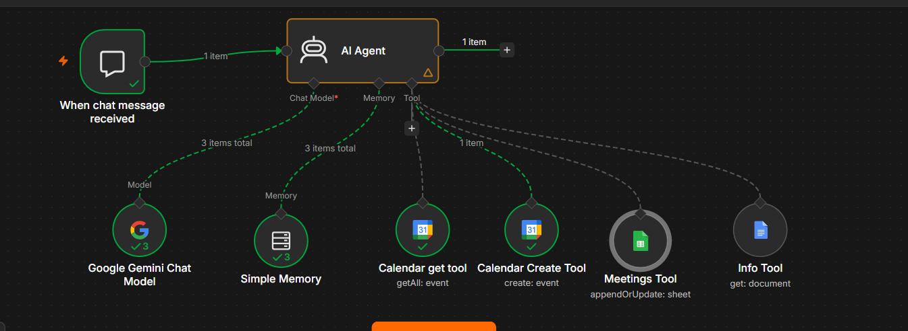

# AI Meeting Scheduler Chatbot

An n8n conversational workflow that helps users schedule meetings using Google Gemini, Google Calendar, and Google Sheets.

## Workflow

## How it works

1. The chat trigger receives a meeting request.
2. The Gemini-powered AI Agent interprets the request and can ask follow-up questions when details are missing.
3. The agent can use the Google Calendar Get tool to retrieve calendar events if events already occurs then ask for the new event.
4. The Calendar Create tool creates the requested event.
5. The Meetings tool records appointment details in Google Sheets and check for duplicate records.
6. The Info tool retrieves company information from a Google document.
7. The agent responds to the user in chat.

Calendar availability checks and booking behavior depend on the node configuration and agent instructions.

## Workflow components

| Component | Purpose |
|---|---|
| Chat trigger | Receives messages and starts the workflow. |
| AI Agent | Interprets requests and calls connected tools. |
| Google Gemini Chat Model | Provides the language model for the agent. |
| Simple Memory | Keeps short-term conversation context. |
| Calendar Get Tool | Retrieves Google Calendar events. |
| Calendar Create Tool | Creates calendar events. |
| Meetings Tool | Adds or updates meeting details in Google Sheets. |
| Info Tool | Retrieves information from a Google document. |

## Google Sheets and duplicate rows

The sheet should have one header row, for example:

AppointmentKey | S.N. | Name | Contact | Company | Address | Reason | StartTime | EndTime | CalendarEventID

To avoid duplicate rows, configure the Google Sheets node to use Append or Update Row and set Column to match on to AppointmentKey. Map a value that is stable for the same booking. A Calendar event ID can prevent repeated rows for the same event, but it will not prevent duplicate Calendar events if each run creates a new event (each new event has a different ID). Preventing duplicate bookings requires checking a stable booking/request ID before creating the Calendar event.

## Technology

- n8n
- Google Gemini
- Google Calendar
- Google Sheets
- Google Docs

## Running the workflow

The workflow JSON is provided for review and can be imported into an active n8n instance. Configure your own Gemini and Google credentials, then select your own Calendar, spreadsheet, and document. Test the workflow with sample data before using it for real appointments.

## Limitations

- Simple Memory provides conversational context; it is not permanent storage.
- The Google Sheets match prevents duplicate rows only when the same appointment key is supplied.
- Calendar event creation and spreadsheet updates are separate operations and may need error handling if one succeeds while the other fails.
- The agent prompt mentions knowledge graph tools, but those tools are not connected in the provided workflow export.

